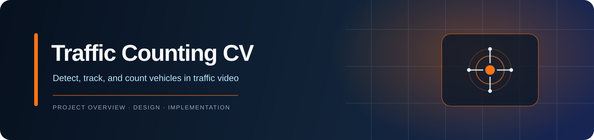
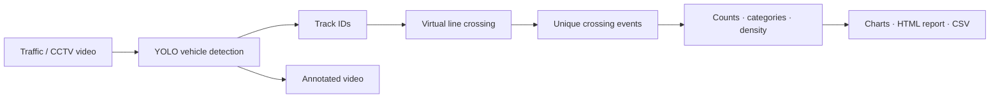

<div align="center">
  
</div>

<div align="center">

**Turn a traffic video into tracked vehicles, crossing counts, and an analysis report.**


[Why this project](#why-this-project) · [Architecture](#architecture) · [Features](#features) · [Quick start](#setup) · [Usage](#usage) · [Configuration](#configuration)

</div>

> **A detection is not a count.**
>
> This project follows vehicle tracks across frames and records a vehicle once when it crosses a configurable virtual line. It turns pre-recorded traffic or CCTV video into annotated footage, category totals, density charts, an HTML report, and CSV events.

## Why this project?

| Principle | What it means |
| :--- | :--- |
| **Count unique vehicles** | YOLO detection is paired with track IDs so one vehicle is not counted again on every frame. |
| **Make the rule visible** | A configurable line and crossing direction define when a tracked vehicle contributes to the count. |
| **Keep outputs useful** | Results include annotated video, category and time-window analytics, a report, and raw crossing events. |
| **Run it your way** | Use a command-line pipeline, browser interface, CustomTkinter GUI, or desktop wrapper. |

## Architecture



## Engineering highlights

| Area | Implementation |
| :--- | :--- |
| **Detection and tracking** | Ultralytics YOLO detects vehicle classes and the configured tracker maintains IDs across frames. |
| **Line-crossing counter** | Relative line coordinates and a selected crossing direction support different camera views; a track is counted once. |
| **Batch processing** | Frame limits and optional annotation help inspect a short clip before processing a full video. |
| **Multiple interfaces** | The same processing project is exposed through CLI, Flask web UI, CustomTkinter GUI, and a PyWebView desktop wrapper. |
| **Analysis artifacts** | Per-category totals, time-window density, charts, HTML report, annotated footage, and event CSV are generated from a run. |

## Features

- **Vehicle detection**: YOLO (Ultralytics) detects cars, motorcycles, buses, and trucks.
- **Object tracking**: ByteTrack assigns a unique ID to each vehicle across frames to avoid duplicate counts.
- **Line-crossing logic**: A configurable virtual line on the road; a vehicle is counted once when its centroid crosses the line in the chosen direction.
- **Statistics**: Total count, category-wise distribution, and traffic density over time.
- **Outputs**:
  - Annotated video with bounding boxes and track IDs
  - Analytics charts (category distribution, density over time)
  - HTML summary report (downloadable)
  - CSV of crossing events for further analysis

## Project Structure

```text
traffic-counting-cv/
├── config.py           Configuration for video, detection, tracking, and counting line
├── detector.py         YOLO detection and tracking adapter
├── tracker.py          Track state and one-time crossing counter
├── video_processor.py  Frame-by-frame processing pipeline
├── analytics.py        Category totals and time-window statistics
├── visualizer.py       Annotated frames and analytics charts
├── report_generator.py HTML summary report generation
├── main.py             Command-line entry point
├── web_app.py          Flask browser interface
├── gui.pyw             CustomTkinter desktop interface
├── desktop_app.py      PyWebView desktop wrapper
├── static/             Browser interface assets
└── output/             Generated artifacts (created at runtime)
```

## Setup

1. **Python**: 3.8 or higher.

2. **Install dependencies**:

   ```bash
   cd traffic-counting-cv
   pip install -r requirements.txt
   ```

   On first run, Ultralytics will download the YOLO weights (e.g. `yolov8n.pt`) automatically.

3. **Input video**: Use any traffic or CCTV clip (e.g. from [Pexels](https://www.pexels.com/search/videos/traffic/), [Pixabay](https://pixabay.com/videos/search/traffic/), or your own file). Place the file in the project folder or pass the full path.

## Usage

### Desktop App (Web GUI in Native Window) 🆕

```bash
python desktop_app.py
```

- **Modern web interface** in a native desktop window (no browser needed)
- Same beautiful UI as the web version
- Auto-scrolls through workflow steps
- Upload videos, adjust settings, and view results
- All outputs accessible via buttons

### GUI (CustomTkinter)

```bash
python gui.pyw
```

- **Browse** to select a traffic video.
- Adjust **counting line** (Y position 0–1) and **confidence** with the sliders.
- Optionally enable **Write annotated video** and set **Limit frames** (0 = all).
- Click **Start processing**. Use **Stop** to cancel.
- View **Total vehicles** and **category breakdown** in Results.
- Use **Open report**, **Open output folder**, or **Play annotated video** after a run.

### Web Interface (Browser)

```bash
python web_app.py
```

Then open your browser to `http://localhost:5000`

### CLI

**Basic run** (process full video and produce all outputs):

```bash
python main.py --video path/to/your_traffic_video.mp4
```

**Options**:

- `--video`, `-v` — **(required)** Path to input video file.
- `--no-annotate` — Skip writing the annotated video (faster).
- `--max-frames N` — Process only the first N frames (quick test).
- `--line-y 0.6` — Relative Y position of the counting line (0–1). Default `0.6` (60% down the frame).
- `--confidence 0.5` — Detection confidence threshold.
- `--output-dir DIR` — Custom output directory (optional).

**Examples**:

```bash
# Full run with default line at 60% of frame height
python main.py --video traffic.mp4

# Quick test: first 300 frames, no annotated video
python main.py --video traffic.mp4 --max-frames 300 --no-annotate

# Counting line at 50% of frame height
python main.py --video traffic.mp4 --line-y 0.5
```

## Configuration

Edit `config.py` to:

- Change **counting line** position: `CountingLineConfig.line_start_rel` and `line_end_rel` (relative 0–1), and `count_direction` (`"up"`, `"down"`, or `"both"`).
- Change **YOLO model**: `DetectionConfig.model_name` (e.g. `yolov8n.pt`, `yolov8s.pt`).
- Change **confidence** and **vehicle classes** (COCO IDs: car=2, motorcycle=3, bus=5, truck=7).
- Point **output paths** to your preferred directories.

## How It Works

1. **Detection**: Each frame is passed to YOLO; only vehicle classes (car, motorcycle, bus, truck) are kept.
2. **Tracking**: YOLO’s built-in tracker (e.g. ByteTrack) assigns a stable `track_id` to each vehicle across frames.
3. **Counting line**: A line is defined (e.g. horizontal at 60% of frame height). The centroid of each tracked vehicle is tested against this line.
4. **Crossing**: When the centroid crosses the line in the configured direction (e.g. downward), that `track_id` is marked as counted and never counted again.
5. **Output**: Crossing events are aggregated into totals, category counts, and time-window density; the annotated video, charts, and report are written.

## Extending to Real-Time

The design is modular and input-agnostic:

- **Input**: In `main.py`, `--video` can be replaced (or extended) to accept a stream URL (e.g. `rtsp://...`). `cv2.VideoCapture(url)` works for many IP/RTSP streams.
- **Processing**: `VideoProcessor.open()` already accepts a string path; the same pipeline runs frame-by-frame. For real-time, you can cap `max_frames` per “batch” or run in a loop reading from the stream.
- **Output**: Annotated video can be written in real time; statistics and report can be generated on a timer or at the end of a session.

## License

This project is for demonstration and education. Use of video content and any deployed system should comply with local laws and privacy requirements.

## Author

**Goutham sai Goparaju**
* Email: gouthamsaigoparaju@gmail.com
* GitHub: https://github.com/Goutham011
